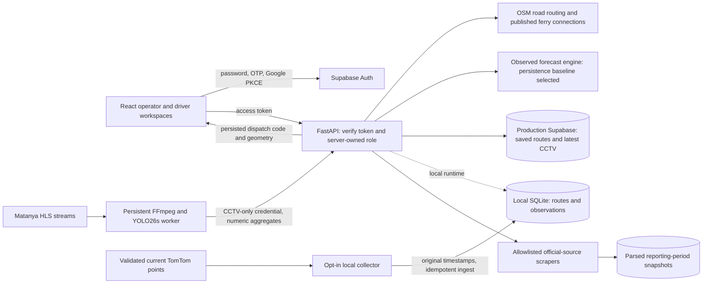

# ⚡ CrossFlow AI — Smart Mobility & Cross-Border Logistics Platform

CCTV is processed in the backend: a persistent Matanya collector runs **YOLO26s → congestion estimates → mapped-road route costs**, feeding the existing route planner and map. Three reviewed road views among 28 registered cameras can influence their exact directed road edges when fresh and eligible. Camera panels and manual image uploads are absent from the frontend. Production uses shared Supabase storage for saved routes and the latest numeric CCTV observations. See the [verified deployment and current coverage](docs/CCTV_LIVE_ROUTING_RELEASE_2026-10-24.md) and [backend CCTV integration](docs/CCTV_CONGESTION.md).

<!-- ML_TRAINING_2026_10_24 -->
**Historical testing expanded:** a source-specific Batam survey test reduces one-hour MAE by 6.47%; a new 61-day Guangzhou speed benchmark evaluates the methodology separately. The local collector now saves prospective Batam forecasts before their targets arrive. See [actual metrics, confidence intervals and geography limits](docs/OBSERVED_ML_TRAINING.md).

**The local runtime now trains on observed traffic only**, with live weather, mapped road context and independent chronological evaluation. It currently selects persistence while the real forests remain provisional; see [current runtime and evidence](docs/OBSERVED_ML_TRAINING.md).

Real-data ML experiments are now available: [training results, engine changes and limits](docs/ML_ENGINE_TRAINING_2026-10-24.md). Batam single-site speed and foreign traffic-count results are separate from the serving demo model.

> **Batam-Singapore Hackathon 2026 Submission**  
> **Track 2: Ease of Living & Sustainability — Smart Mobility Flow**

CrossFlow AI is a smart-mobility and cross-border logistics planning platform
for the **Batam-Singapore Corridor**. It combines road routing, planning-grade
congestion forecasts and published ferry schedules in a door-to-door journey
view. The product distinguishes official reference data, optional observations
and modelled estimates; it does not present a timetable, queue estimate or
forecast as live unless a connected source actually supplies a fresh
observation.


---

## 🌟 Key Features

1. **Vehicle-Aware Road Routing (OpenStreetMap + A\*)**
   - Batam road-following paths are computed over a 115,320-node schema-v3 union-retention graph of mapped motor roads. Each request selects a mutually reachable core for its vehicle mode; the committed metadata preserves access, motorcycle/HGV rules, surface, width, height, weight, speed and lane tags when OSM publishes them. A stateful A\* supports five audited objectives: **Balanced**, **Fastest**, **Shortest**, **Easy**, and **Local shortcuts**, with vehicle-specific time, distance, congestion and road-quality weights. Missing physical tags use declared conservative fallbacks rather than invented measurements. Singapore and cross-border road-access legs request OSRM routes over OpenStreetMap; an unavailable road service produces an explicitly labelled continuity estimate, not turn-by-turn navigation.
2. **Congestion Forecasting & Telemetry**
   - 30- and 60-minute planning forecasts cover **30 representative Batam mobility hotspots: 20 critical-priority and 10 heavy-priority locations**. The split is a product watch-list taxonomy, not an official Batam classification or a claim about current conditions. Scores respond to time of day, weekday/weekend, weather, local baselines and ferry-departure density. Each hotspot is accompanied by a dated reference photograph and is labelled modelled unless a successful point observation supplies its own source and timestamp.
3. **Singapore ↔ Batam Door-to-Door Journey Solver**
   - Free-text or map-picked endpoints can be anywhere in the supported Singapore and Batam bounds. A cross-border plan is composed as **Singapore road access → published ferry terminal corridor → Batam road access**, or the reverse. Candidate crossings are restricted to published terminal pairs through HarbourFront or Tanah Merah and Batam Centre, Harbour Bay, Sekupang or Nongsa Pura; the solver does not invent informal small-channel crossings. Every leg carries its own provider, geometry and limitation. Ferry lines are channel-aware planning geometry, not an observed vessel track, while the selected departure is asserted only when the bundled operator snapshot contains a matching sailing. Same-island Batam journeys retain the full local A\* objectives and alternatives.
4. **Ferry & Port Intelligence**
   - Source-dated operator timetable snapshots cover published Batam-Singapore sailings, alongside official BP Batam terminal references. Upcoming published departures are computed at request time. Live queues, processing, occupancy and operating status remain unavailable without an observed source; verify conditions with the terminal or operator before travel.
5. **Operations & Carbon Analytics Dashboard**
   - Current congestion and bottlenecks derive from fresh validated TomTom representative-point speeds, with actual sample timestamps and coverage counts. Mapped CCTV estimates remain separately labelled. Missing measurements stay unavailable. Analytics contains **Overview**, **Ports** and **History**; History presents a clearly labelled modelled traffic-flow scenario, separate from measured traffic archives. Unsupported fleet, emissions and historical-performance figures are not invented.

---

## 🔍 Data & Model Provenance

Every operational card is intended to answer three questions: **where did this
come from, when was it valid, and is it observed or estimated?** API responses
carry provenance fields, and the UI reads them instead of inferring that a
successful request must be live.

| Component | Source | Status |
|---|---|---|
| Batam road network | OpenStreetMap via Overpass (ODbL 1.0) | **Real** |
| Batam route geometry, distances, alternatives and manoeuvres | Computed from the committed OSM graph | Mapped road plan |
| Singapore/cross-border road-access legs | OSRM over OpenStreetMap when reachable | Mapped road plan; labelled continuity estimate when unavailable |
| Vehicle, route-objective, congestion and weather weights | Published planning assumptions over OSM edges | Modelled |
| Route-learning observation store | Admin-authorized, map-matched first-party traversals keyed to the exact committed OSM graph | Optional; empty until verified telemetry is ingested |
| Landmark coordinates | Verified against OSM features | **Real** |
| Point traffic observations | Fresh validated TomTom responses through a server-side key or the configured project relay | Commercial point observation; not Batam-government telemetry |
| CCTV route-search inputs | Public Matanya views, pretrained YOLO26s and reviewed directed-edge bindings for cameras 13, 51 and 48 | Three mapped road views among 28 registered cameras; fresh eligible estimates affect route-search costs; independent camera validation pending; no inferred physical speed |
| 30 Batam planning hotspots (20 critical / 10 heavy) | Representative locations, local-area profiles and synthetic Random Forest inputs | Modelled watch-list priorities; not official severity labels |
| Observed congestion history | Bounded validated spatial observations from the configured local/shared store | Empty until measured records exist; synthetic seeds excluded by default |
| Legacy engineering history preview | Rolling synthetic seed and modelled telemetry snapshots, available only with explicit `include_modelled=true` | Non-observed; excluded from the default dashboard history |
| Typed spatial speed history | Numeric, geocoded, timezone-aware `V_actual` and `V_free_flow` records with fixed source policy | Optional; idempotent and provenance-labelled, stored in local SQLite or the server-only Supabase adapter when explicitly configured |
| Operations congestion and bottlenecks | Fresh measured representative-point speed/free-flow ratios | Timestamped point-derived index with explicit coverage; unavailable on provider failure |
| Operational emissions savings and fleet composition | No measured fleet or emissions feed | Unavailable; scenario curves/splits are not dashboard evidence |
| Ferry departure slots | Source-dated published timetables from BatamFast, Sindo, Majestic and Horizon; official source links retained | Last-known-good schedule snapshot, not live operations |
| Passenger queue, processing time and berth occupancy | No connected observed terminal-operations feed | Unavailable |
| Terminal identity, location and facilities | BP Batam official passenger-port and terminal pages | Official reference information; not live occupancy |
| Ferry vessels, seats, gates, berths, cancellations | No licensed public machine feed is connected | Unavailable; never fabricated |
| Cargo consignments | No connected live tracking feed | Unavailable in the operational workspace; engineering fixtures are not actual shipments |

The traffic score models network demand and queue conditions, while the
separately reported weather term models safe-speed loss on wet roads. They are
kept separate in each route's cost breakdown so the estimate can be audited.
Default historical metadata reports only validated observed rows for the
requested Batam calendar-day window. Empty buckets remain null, not zero or a
synthetic profile. Model validation metrics describe the trained model and its
declared evaluation scope; they should change only after a real training run.

The corridor card, feed list and map colours use timestamped `observed_traffic`
from `/api/corridors`, with explicit partial coverage and source expiry.
Bundled planning values cannot populate live conditions. Genuine measured zero
is retained; missing or expired observations display **Unavailable**. A
hold-latest outlook is labelled **Latest-observation baseline**, and a point or
camera view cannot establish a whole-corridor physical delay. These reads do
not create historical records.

Live corridor conditions and the observed analytics distribution use the shared
versioned `observed_speed_loss_bands_v2` policy:
**Free flow** at an index up to 5, **Slowing** above 5 and below 20,
**Heavy** from 20 to below 40, and **Critical** at 40 or above. These more
sensitive warning bands preserve the measured speed-loss index. They are
engineering display bands, not independently calibrated traffic service levels.
Only valid measured speeds with provider confidence of at least 0.5 qualify.
Image-only evidence is labelled **Camera estimate**, including an empty view;
it cannot establish measured free flow. A fresh mapped camera estimate at 40 or
above produces a separate local-congestion warning when the provider point is
below 40. Its own expiry withdraws the warning without extending the provider
measurement. No rule forces a mix of conditions when all sampled points are clear.
Unqualified analytics entries remain neutral rather than being counted as free
flow. The displayed **Congestion pressure** is a separate, versioned
`congestion_pressure_v1` sensitivity scale: `min(100, source_index * 2.5)`,
rounded to one decimal. It applies only to an available primary source and
preserves the original speed-loss or camera-proxy index in the API. A raw index
of 20 therefore yields pressure 50, while 40 yields pressure 100. Camera-derived
pressure remains estimated; it is not measured road speed. The operations mean
averages the capped pressure of each qualified provider point, rather than
amplifying the mean or blending camera and provider units. This multiplier is an
engineering sensitivity setting, not a calibration or accuracy improvement.
Missing pressure fields cannot fall back to a raw or synthetic value in the UI.
Hotspot cards label their value **Modelled pressure**, with
`pressure_basis=modelled_congestion_index`: the multiplier applies to the
backend's published modelled `congestion_index`, never `selection_score`.
Selection scores include recurrence, network role, demand and evidence weights;
they determine the watch order and tier, not measured traffic severity. For
example, Panbil can have selection score 45.5 while its modelled congestion is
10.2 and its displayed pressure is 25.5. Missing modelled-pressure metadata shows
Unavailable, with no fallback to bundled priority scores. These area estimates
remain distinct from live provider measurements and exact road-camera views.
A failed workspace bundle displays an explicit reload action instead of a
blank page; it does not automatically reload and discard an in-progress draft.

The simplified **History** workspace requests
`/api/historical-congestion?modelled_only=true`. This mode selects only the
identified synthetic scenario seed and excludes measured, unknown and ambiguous
legacy `simulated` rows. It computes modelled hourly/daily profiles in the
backend and labels them as possible traffic patterns, not observed history.
Default measured-history APIs remain available separately. Journey maps label
all resolved stops **A, B, C, D…** in the planned order, including saved driver
dispatches. Interface report periods use English; proper place names and source
records retain their original names and provenance.

The operator's `POST /api/analytics/simulation` endpoint computes a useful
24-hour model forecast with P10/mean/P90 and weather counterfactuals. It accepts
`weather` (0–2) and optional unique `corridor_ids` (up to five); the server owns
the clock and fixed work bound of 135 ensemble predictions. This is explicitly
a simulation, never measured traffic history. Use `include_modelled=true` on
the history endpoint only for its labelled engineering preview.

For an actual local traffic archive, opt in with
`CROSSFLOW_ARCHIVE_LIVE_TRAFFIC=1` and a persistent `CROSSFLOW_HISTORY_DB`.
The lifecycle collector polls validated current TomTom samples every 120
seconds, preserves original timestamps and deduplicates identical snapshots.
Collection starts now; it cannot reconstruct earlier observed conditions.
Traffic dashboard reads do not create observation rows, and serverless/shared-store collection is
disabled. Collector state is exposed in operations/history metadata.

### Runtime architecture and trust boundaries



Passwords, OTPs and OAuth credentials stay with Supabase's authentication flow;
application roles are resolved by the API from the protected profile. Planning
and ML scenario requests require operator permission. Drivers retrieve persisted
journeys by dispatch code, while account history is scoped separately. A route
code is issued only after a storage write succeeds.

Provider integrations have bounded requests, validated payloads and explicit
freshness. The traffic collector writes measured observations; the simulation
engine does not. The official-report scraper retains only successfully parsed
published records and marks a failed refresh stale. Local files survive a local
restart but do not provide shared cloud storage. Production saved-route and
CCTV migrations and shared storage have been verified; other optional history
adapters retain separate configuration and deployment requirements. See the
[production verification report](docs/CCTV_LIVE_ROUTING_RELEASE_2026-10-24.md).

**On the model:** this workspace enables `CROSSFLOW_REAL_TRAFFIC_TRAINING=1`.
Its real-only runtime fits three 100-tree forests for 15/30/60 minutes using
43 features from actual traffic history, available weather and nearby mapped
road context. It uses chronological fit/validation/calibration/test partitions,
60-minute purges, explicit ingestion/capture times and zero synthetic labels.
Validation currently selects persistence at all horizons; the fitted forests are
reported honestly beside that stronger baseline. Hourly retraining runs while
the local backend is up and keeps the previous complete JSON model on failure.

The initial 1,064-record archive spans only 9.6 hours. Weather capture has started,
but eligible historical weather-training pairs are initially zero. Release
checks remain provisional and sparse prediction intervals are withheld. OSM
tags are mapped context, not verified lane/direction/capacity measurements;
Open-Meteo is a regional weather model grid, not a roadside sensor. Forecasts
cover five monitored points and at most one hour. Later route contexts carry a
labelled latest-observed reference, with no assumed synthetic/ferry adjustment.
See [actual results and reproducible commands](docs/OBSERVED_ML_TRAINING.md).

The older synthetic cold-start/research implementation remains explicitly
available only when observed-only mode is disabled. Its R², MAE, RMSE, tree
quantiles and scenario tests are not field-accuracy evidence. The default
history continues to exclude synthetic seeds and modelled observations.

Queue/processing/berth measurements remain unavailable. Public official pages
provide terminal descriptions, aggregate passenger volumes, schedules and
process guidance, but no documented public feed of Batam passenger wait,
immigration processing, berth occupancy, gates, seats or cancellations was
found. A successful page scrape would not itself make a value authoritative or
grant redistribution rights.

### Authoritative references and integration boundaries

- **Batam traffic:** [Dishub Batam traffic cameras](https://dishub.batam.go.id/cctv-lalu-lintas-kota-batam/), the [2024 Dishub performance report](https://dishub.batam.go.id/wp-content/uploads/sites/3/2025/02/DISHUB_LAKIP_2024.pdf) and the [2021–2026 strategic plan](https://dishub.batam.go.id/wp-content/uploads/sites/3/2025/02/DISHUB_RENSTRA2021-2026.pdf). The 2024 report records the official ATCS/intersection inventory; it does not publish current congestion labels. The camera page has no documented public machine API, so a camera can be called current only after a successful timestamped fetch.
- **Batam open data:** [Satu Data Kota Batam](https://satudata.batam.go.id/data/) publishes downloadable civic datasets, and [BP Batam Open Data](https://data.bpbatam.go.id/dataset/?groups=transportasi) publishes agency datasets. The available road and infrastructure series are useful context, not a live segment-speed feed.
- **Ferry terminals and port totals:** [BP Batam passenger ports](https://batamport.bpbatam.go.id/pelabuhan-penumpang/) and its official pages for [Batam Centre](https://batamport.bpbatam.go.id/batam-centre/), [Sekupang](https://batamport.bpbatam.go.id/sekupang/), [Harbour Bay](https://batamport.bpbatam.go.id/harbour-bay/) and [Nongsapura](https://batamport.bpbatam.go.id/nongsapura/) provide terminal identity, facilities, routes and published aggregates. [B-SIMS](https://b-sims.bpbatam.go.id/) is an account-based port-service system for authorized users, not a public passenger-status API.
- **Ferry schedules:** “Check Schedules” validates six reviewed official pages: recurring operator timetables from [BatamFast](https://www.batamfast.com/tripschedule/index.ashx), [Sindo Ferry](https://app.sindoferry.com.sg/schedule/), [Majestic Fast Ferry](https://www.majesticfastferry.com.sg/) and [Horizon Fast Ferry](https://horizonfastferry.com.sg/), the [BP Batam passenger-terminal catalogue](https://batamport.bpbatam.go.id/pelabuhan-penumpang/), and the date-bound [Singapore Cruise Centre ferry board](https://singaporecruise.com.sg/schedule/ferries/). BP Batam supplies terminal context rather than departure slots. SCC rows are validated as same-day operations and never overwrite recurring operator timetables. Deployments remain responsible for the SCC site's stated linking/reuse terms.
- **Passenger processing:** the [Singapore Cruise Centre departure guide](https://singaporecruise.com.sg/departure-arrival/ferry/) publishes check-in and gate windows, while [Singapore ICA checkpoint information](https://www.ica.gov.sg/about-us/our-checkpoints) describes the official checkpoints. Neither source publishes a Batam-terminal live wait-time API.
- **Singapore road data:** [SLA OneMap](https://www.onemap.gov.sg/apidocs/) supports authoritative Singapore search and routing, and [LTA DataMall](https://datamall.lta.gov.sg/content/datamall/en/dynamic-data.html) offers key-gated traffic speed bands, incidents and images. These are integration options rather than evidence that the current browser fallback is live; OneMap routing also does not extend into Batam.
- **Maritime logistics:** [MPA OCEANS-X](https://oceans-x.mpa.gov.sg/) and the [Singapore Maritime Data Hub vessel-arrivals API](https://sg-mdh.mpa.gov.sg/vessel-arrivals/apis) provide subscribed maritime data. They can enrich cargo and vessel planning, but they do not provide Batam passenger queue minutes.
- **Reference photographs:** hotspot and terminal photographs are historical orientation aids, never congestion observations. Reusable examples include [Jalan Sudirman](https://commons.wikimedia.org/wiki/File:Jalan_Panglima_Besar_Sudirman,_Batam,_Riau_Islands.jpg), [Batam Centre](https://commons.wikimedia.org/wiki/File:Terminal_Ferry_Batam_Centre.JPG), [Sekupang](https://commons.wikimedia.org/wiki/File:Sekupang_Ferry_Terminal.jpg) and [Harbour Bay](https://commons.wikimedia.org/wiki/File:Harbour_Bay_Ferry_terminal.jpg). The hotspot catalogue retains the Commons author, licence, capture year and source. BP Batam page imagery has no clear reuse licence and requires permission before redistribution.

Published sailing times use the terminal's local timezone: Singapore is SGT
(UTC+8), while Batam is WIB (UTC+7). The optimizer normalizes timestamps for
calculation and should always display the local zone on a cross-border leg.

The protected route-learning store accepts only clear-weather, low-congestion
actual traversal observations from allowlisted map-matching pipelines. Inputs
are exact directed OSM edge keys tied to the SHA-256 of the committed graph;
stale graph observations are isolated automatically. Its API schema has no
route geometry, polyline, provider route, or provider duration fields. Google
Routes content is never accepted, cached, or persisted. A\* captures one
immutable snapshot per calculation and applies it only on clear-weather edges
whose network and local congestion scores are at most 25. Every response
publishes the baseline-versus-learned adjustment, model revision, gate state,
and selected-edge audit; external provider geometry strips those local claims.

An optional `POST /api/route-benchmark` comparison is disabled by default. It
uses a dedicated server-only Google Routes v2 key and sends coordinates to
Google only when the explicit enable flag is set. The field mask permits only
duration, distance and route labels—never geometry, polylines or steps—and the
response is `private, no-store`, cannot be persisted or used for training, and
cannot be drawn over the OpenStreetMap map. Shortest-distance reference
routes are clearly labelled experimental. The frontend action is separately
opted in only when `VITE_ENABLE_GOOGLE_BENCHMARK=true`; it renders attributed
distance/duration text in its own card and never sends provider content to the
Leaflet map or browser storage.

The staged activation and camera-feed path is documented in
[`docs/LIVE_TRAFFIC_AND_FEED_PLAN.md`](docs/LIVE_TRAFFIC_AND_FEED_PLAN.md).

### Routing-intelligence backend

The refactored backend keeps graph search, traffic validation, shortcut review,
model inference, and persistence behind typed service boundaries. The local
Batam solver uses vehicle-constrained, turn-aware A* and publishes the
four-component edge objective
`time + distance + congestion + road-quality penalty` with per-vehicle weights
and explicit fallbacks for unrated roads. Crowd-sourced route tips are parsed
only from a server-owned pinned-source policy and remain inactive until a human
review produces an immutable approval for the current graph revision.

Typed spatial history stores timezone-aware `V_actual / V_free_flow` records
with fixed provenance and idempotent keys. The probabilistic random-forest
contract publishes empirical quantiles and calibration metadata, while a
transparent ferry-schedule adjustment stays separate from observed traffic.
Local SQLite remains the development default; optional server-only Supabase
durability is available through
[`backend/data/routing_intelligence.sql`](backend/data/routing_intelligence.sql).
See [Routing Intelligence Architecture](docs/ROUTING_INTELLIGENCE_ARCHITECTURE.md)
for the cost units, vehicle constraints, source-policy schema, retention,
review/promotion flow, RLS boundary, cache, and fallback behavior.

### Congestion calculation and validation

Current/30/60-minute forecasts share a bounded batch engine. Measured speeds,
training labels and historical estimates use one congestion-score definition;
stopped measurements are retained while routing costs remain finite. Shared
route history now keeps independent account associations, and local storage
failure no longer blocks a healthy shared lookup.

The local demo can reuse the existing public Vercel traffic feed without
copying production keys: set `CROSSFLOW_TRAFFIC_UPSTREAM_URL` to
`https://cross-flow-ai.vercel.app/api/live-traffic` in the gitignored root
`.env`. This relay is local-only, validates source/freshness and retains only a
short in-memory snapshot. Thirty hotspot areas remain modelled estimates.

A reproducible 2,000,000-scenario inference run passed numerical invariants.
Chronological backtesting compares the forest with latest-speed and history
baselines, excludes future measurements, and reports insufficient observed
history honestly. See [engine validation](docs/CONGESTION_ENGINE_VALIDATION.md)
for results, the protected backtest endpoint, migration order and limitations.

### Authentication and the credential boundary

Human sign-in (admins and drivers) is separate from the machine secret that
guards ingestion and retraining. `CROSSFLOW_ADMIN_TOKEN` remains a shared
deployment credential for backend-to-backend operations; it is never a login,
and presenting it as a user token is rejected.

Identity comes from Supabase Auth. Clients authenticate with Supabase
**directly**, so this API never receives a password and inherits Supabase's rate
limiting, lockout and password-reset handling. The API receives only the
resulting access token, verifies it, and resolves the caller's role from
`crossflow_profiles` — never from the request body, and never from the token's
own `user_metadata`, which users can write themselves.

Three credentials, three purposes. Confusing them is the one mistake that
disables every access-control policy while leaving the application apparently
working:

| Credential | Used by | Subject to row-level security |
|---|---|---|
| `SUPABASE_SECRET_KEY` | Backend-owned tables, ingestion, background jobs | **No — bypasses it entirely** |
| `SUPABASE_PUBLISHABLE_KEY` | Identifies the project on user-scoped calls | n/a — grants nothing alone |
| The caller's access token | Every admin and driver read or write | **Yes — this is the boundary** |

The separation is structural rather than conventional:
[`backend/auth/transport.py`](backend/auth/transport.py) never reads a secret
key from the environment, and a test asserts that it cannot. Apply
[`backend/auth/schema.sql`](backend/auth/schema.sql) and set
`CROSSFLOW_AUTH_MODE=supabase` enables the server-side auth routes; the browser
also needs matching `VITE_SUPABASE_URL` and `VITE_SUPABASE_PUBLISHABLE_KEY`.
Until the server mode is enabled, every public corridor, ferry and model
endpoint keeps serving unauthenticated, and only the `/api/auth/*` routes report
that sign-in is unavailable. Auth is a per-route dependency, never middleware,
so an unreachable Supabase cannot blank the app.
See [Auth Backend Roadmap](docs/AUTH_BACKEND_ROADMAP.md).

---

## 🏗️ Tech Stack

| Part | Technology | What it does |
|---|---|---|
| **Frontend** | React 18 + TypeScript + Vite | Operator and driver interfaces |
| **Styling** | Custom CSS + self-hosted Plus Jakarta Sans | Website appearance and shared typography |
| **Maps** | Leaflet + OpenStreetMap | Roads, congestion overlays and journey maps |
| **Charts** | Recharts | Analytics and historical trends |
| **Backend** | Python 3.12 baseline + FastAPI + Uvicorn | APIs, analytics, routing and local background collectors |
| **Data validation** | Pydantic | Validates incoming requests and typed data |
| **Vehicle detection** | Ultralytics **YOLO26s** + PyTorch | Detects cars, motorcycles, buses, trucks and bicycles in the separate CV worker |
| **Video processing** | HLS streams + FFmpeg + custom temporal tracking | Decodes live frames in memory and estimates movement and occupancy |
| **Traffic forecasting** | NumPy + scikit-learn Random Forest candidates | Evaluates 15-, 30- and 60-minute predictions; the deployed observed-only forecast currently serves persistence |
| **Route algorithm** | Custom stateful A\* over the Batam OSM graph | Selects routes using vehicle restrictions, route objectives and eligible traffic costs |
| **Journey composition** | FastAPI journey composer + published ferry timetable snapshots | Combines road access, supported terminal pairs and published ferry connections |
| **Storage** | Local SQLite + server-only Supabase adapters | SQLite supports local records; production Supabase stores shared saved routes and latest numeric CCTV observations; other history/evaluation adapters are optional |
| **Authentication** | Supabase Auth | Google sign-in, email/password and one-time email sign-in codes |
| **Hosting & delivery** | Vercel + GitHub main and GitHub Actions | Hosts the frontend and FastAPI APIs, deploys commits and runs regression checks; the continuous CV worker runs separately |

### External integrations

- **TomTom Traffic API:** measured point road speeds and free-flow speeds, with source timestamps and freshness checks.
- **Matanya Batam:** public CCTV HLS streams processed by the backend collector; reviewed camera-to-road bindings feed route-search costs.
- **Open-Meteo:** regional weather context for traffic analytics and forecasts.
- **Nominatim:** place search and reverse geocoding.
- **OSRM:** mapped Singapore road-access routes used in composed journeys, with explicit fallback labels on failure.
- **Official ferry websites:** published timetable collection and verification through custom Python scrapers; schedules remain separate from unavailable live queues, berth occupancy and cargo status.

### Integration layer

The application uses **REST/JSON APIs**, browser `fetch`, the **Supabase
JavaScript SDK**, Google OAuth with **PKCE**, and authenticated bearer tokens.
Supabase handles passwords and email codes directly; email-code sign-in is
not restricted to Gmail and does not use the Gmail API. Vite proxies local
frontend API requests to FastAPI. In production, Vercel routes `/api/*` to
FastAPI. The separate CV collector submits numeric aggregates over HTTPS with
a dedicated CCTV-only credential; raw camera frames stay out of the cloud
ingestion payload and frontend.

### Current deployment and model limits

- **Vehicle detector:** the selected model is pretrained YOLO26s. Independent Batam vehicle-counting validation remains pending; no field-accuracy percentage is claimed.
- **Forecasting:** production serves the **persistence baseline**, carrying forward the latest fresh measured congestion. Random Forest candidates have not passed the release checks for promotion. Cloud requests do not retrain the model or fabricate historical observations.
- **CCTV routing:** cameras **13** (Jalan Engku Putri eastbound), **51** (Jalan Engku Putri westbound) and **48** (Jalan Jenderal Ahmad Yani toward Batu Aji) have reviewed directed-road mappings. Fresh eligible estimates already affect route-search costs. They are provisional image-based congestion estimates, without calibrated physical speed or measured-delay claims. Expired or revoked evidence is excluded from new route searches; an issued driver dispatch retains its saved route.
- **Coverage and uptime:** the 24 October 2026 audit found five advancing streams and 23 ended streams among 28 registered cameras. Camera 1 is a disabled civic-plaza view; camera 19 remains aggregate-only while its exact road binding is unresolved. Eligibility is recomputed from current freshness and quality. The continuous collector currently runs on this computer; sleep, shutdown or network loss stops updates, after which stale evidence withdraws automatically.
- **Shared history:** saved routes and latest CCTV evidence are deployed to shared Supabase storage. Shared historical traffic archiving and continuous prospective cloud evaluation require separate infrastructure; Vercel does not host a permanent YOLO process.

Deployment evidence and the operator-to-driver dispatch check are documented in
the [live CCTV routing release report](docs/CCTV_LIVE_ROUTING_RELEASE_2026-10-24.md).

---

## 📁 Project Structure

```
├── backend/      # FastAPI + scikit-learn API and backend regression runner
│   └── auth/     # Human sign-in: schema, user-scoped transport, boundary tests
├── frontend/     # React 18 + Vite + TypeScript dashboard and Vitest checks
├── scripts/      # Local launcher, graph tooling, and optional training jobs
├── .github/      # GitHub Actions CI
└── docs/         # Pitch outline, hackathon reference, and the standalone
                  # auth sign-in demo page (docs/auth-signin-demo.html)
```

---

## 🚀 Quick Start

### Prerequisites
- Node.js 24 LTS, v24.15+ (CI uses v24.19.0)
- Python 3.12+

### One command

```bash
./scripts/dev.sh
```

Installs anything missing (Python venv + backend requirements, and
`npm ci`), then runs the backend on **:8000** and the frontend on
**:3000** together. Ctrl+C stops both.

| | |
|---|---|
| Dashboard | <http://localhost:3000> |
| API docs | <http://localhost:8000/docs> |

Options: `--install-only`, `--backend-only`, `--frontend-only`, `--clean`,
and `--force-restart`.

---

## FastAPI route-planning contract

The interactive API is available at `http://localhost:8000` (OpenAPI UI at
`/docs`). Route planning has three POST endpoints:

With `CROSSFLOW_AUTH_MODE=supabase`, each planning request requires the verified
operator/admin session's `Authorization: Bearer …` header. Missing credentials
return 401 and driver accounts return 403 before route computation. Explicit
auth-disabled development mode retains guest planning.

| Endpoint | Request shape |
|---|---|
| `POST /api/optimize-route` | A named `corridor_id`, or both `origin_id` and `destination_id`, plus the required `vehicle_type`. |
| `POST /api/optimize-free-route` | Required `origin_lat`, `origin_lng`, `destination_lat`, and `destination_lng`; optional display names and route settings. |
| `POST /api/optimize-multi-stop-route` | An ordered `stops` array with 3–5 stops (origin, destination, and up to 3 intermediate stops). Each stop has `lat`, `lng`, optional `name`, and optional `dwell_mins`; `optimize_order` defaults to `false`. |

All three request types also accept `weather` (`0` clear, `1` rain, `2`
storm), `route_preference` (`BALANCED`, `FASTEST`, `SHORTEST`, `EASY`, or
`LOCAL`), and the legacy `hour` field (`0`–`23`, default `14`). For a precise
schedule, send exactly one of `departure_at` or `arrive_by` as a timezone-aware
ISO-8601 timestamp. They are mutually exclusive, and a timestamp without an
offset is rejected. `+07:00` (Batam) and `+08:00` (Singapore) are accepted;
the solver normalizes them for calculation and returns timezone-aware times.
If neither timestamp is provided, `hour` remains the backwards-compatible
hour-of-day mode. An `arrive_by` request searches for the latest feasible
departure in a bounded 48-hour window and returns HTTP 400 when no feasible
departure is found.

Example departure-time request:

```json
{
  "origin_lat": 1.0605,
  "origin_lng": 104.0303,
  "destination_lat": 1.1318,
  "destination_lng": 104.0554,
  "vehicle_type": "COMMUTER",
  "departure_at": "2026-08-15T08:30:00+07:00",
  "route_preference": "BALANCED"
}
```

To request an arrival deadline, replace `departure_at` with (not in addition
to) an `arrive_by` value, for example
`"arrive_by": "2026-08-15T10:00:00+07:00"`. A multi-stop body uses the same
scheduling fields:

```json
{
  "stops": [
    {"lat": 1.1630, "lng": 104.0025, "name": "Batu Ampar"},
    {"lat": 1.1465, "lng": 104.0125, "name": "Nagoya Hill", "dwell_mins": 15},
    {"lat": 1.1318, "lng": 104.0554, "name": "Batam Centre"}
  ],
  "vehicle_type": "LIGHT_TRUCK",
  "arrive_by": "2026-08-15T13:00:00+07:00"
}
```

Successful responses are flat envelopes: `generated_at`, `data_source`, and
`provenance` are returned alongside the route result. The route identity fields
are:

- `route_id`: the full 64-character lowercase SHA-256 content hash.
- `route_code`: a deterministic, driver-friendly 7-character dispatch code.
  It is issued only after local or shared storage confirms a write. Public
  lookup accepts it as a shareable route capability.
- `dispatch_available`: whether a store confirmed the route can be retrieved.
  If both writes fail, the calculated journey remains a preview with
  `dispatch_available: false` and `route_code: null`; its internal `route_id`
  must not be presented as an assignable code.
- `route_storage`: confirmed source, shared/local scope and durability. A
  local SQLite code is scoped to the current host; an ephemeral or memory
  store does not provide durable cross-worker dispatch.

The route result includes `route_type`, `planned_departure`,
`estimated_arrival`, `estimated_travel_time_mins`, `total_eta_mins`,
`route_geometry` (latitude/longitude pairs), `legs` where applicable, and a
`scheduling` object. The scheduling object reports `mode` (`HOUR`, `DEPART_AT`,
or `ARRIVE_BY`), the requested timestamp, and `deadline_slack_mins` when an
arrival deadline was used. Representative response excerpt:

```json
{
  "generated_at": "2026-08-15T01:30:04+00:00",
  "data_source": "simulated",
  "provenance": {"road_network": "OpenStreetMap Batam Extract", "traffic": "Historical & Telemetry Model"},
  "route_id": "0123456789abcdef0123456789abcdef0123456789abcdef0123456789abcdef",
  "route_code": "7KQ4MNP",
  "route_type": "ROAD_ROUTE",
  "planned_departure": "2026-08-15T08:30:00+07:00",
  "estimated_arrival": "2026-08-15T08:56:00+07:00",
  "estimated_travel_time_mins": 26.0,
  "total_eta_mins": 26,
  "route_geometry": [[1.0605, 104.0303], [1.1318, 104.0554]],
  "scheduling": {
    "mode": "DEPART_AT",
    "requested_departure_at": "2026-08-15T08:30:00+07:00",
    "requested_arrive_by": null,
    "deadline_slack_mins": null
  }
}
```

The excerpt is shortened; multimodal and multi-stop responses add their
normal `legs`, ferry, stop, and navigation fields. Use the actual
`route_id` or `route_code` to retrieve a persisted response:

```http
GET /api/routes/7KQ4MNP
```

The equivalent `/routes/{route_id}` path is also available. Retrieval accepts
either the 64-character hash or 7-character code without a login. Anyone with
the code can retrieve that route; do not attach sensitive passenger or cargo
details to these public responses. Route history listing (`GET /api/routes`)
requires a verified account and scopes drivers to their own runs. Responses
are marked `Cache-Control: private, no-store`.

---

## 🔧 Manual Setup

### 1. Frontend Web Application Setup
```bash
cd frontend

# Install the locked Node dependencies
npm ci

# Launch frontend dev server on http://localhost:3000
npm run dev
```

### 2. Python AI Backend Setup
```bash
# Create & activate virtual environment
python3 -m venv .venv
source .venv/bin/activate

# Install backend dependencies
pip install -r backend/requirements.txt

# Run backend API server on http://localhost:8000
python backend/main.py
```

### 3. Run the primary local verification

The commands below mirror the frontend and backend checks in GitHub Actions.
The backend function-style tests require the CI-only `pytest` package, so install
it into the virtual environment if it is not already present. The commands use
POSIX paths; on Windows, use the equivalent `.venv\\Scripts\\python.exe` paths
from PowerShell, or run them under WSL/Git Bash.

```bash
# Frontend typecheck/build, lint, and regression tests
cd frontend
npm run lint
npm test
npm run build
cd ..

# Backend regression checks and launcher validation
.venv/bin/python -m compileall -q backend scripts
.venv/bin/python backend/test_backend.py
.venv/bin/python -m unittest discover -s backend/tests -p 'test_*.py'
# Once, if needed, install the CI-only function-test runner
.venv/bin/pip install pytest
(cd backend && ../.venv/bin/python -m pytest tests -q)
.venv/bin/python -m unittest discover -s backend/auth/tests -t . -p 'test_*.py'
# Execute the signup triggers and RLS policies against local PostgreSQL (PGlite)
npm ci --prefix backend/auth
npm test --prefix backend/auth
bash -n scripts/dev.sh
```

The verification suite covers A\* path validity and preference-aware admissibility, all
eight vehicle profiles, all five route-objective catalogs and API validation,
physical-distance versus weighted-objective and modeled-ETA units, requested-hour and
weather weighting, spatial congestion decay and caching, all named planner
pairs, free-point routing and browser fallback, road alternatives, manoeuvres,
roundabouts, access barriers, verified traversal ingestion isolation,
idempotency, graph revisioning, immutable learning snapshots, clear-road gates,
physical speed clamping, learned-path cache invalidation and selected-edge-only
shortcut audits, the opt-in metric-only Google benchmark request/parser,
server-key isolation and no-store failure behavior, timezone-safe Batam schedules, ferry boarding
cutoffs, determinism, and dashboard consistency invariants. GitHub Actions runs
these commands for every push and pull request.

### 4. Optional configuration

The application runs with simulated traffic and local OSM routing when no
secrets are configured. Set only the integrations you use:

| Variable | Purpose |
|---|---|
| `VITE_API_BASE_URL` | API origin for a split frontend/backend deployment; local Vite and the bundled Vercel config use same-origin `/api` by default. |
| `VITE_API_ENABLED` | Set to `false` for emergency demo mode: skip unavailable application API calls and use bundled simulations. Supabase browser authentication is unaffected. |
| `VITE_SUPABASE_URL` | Supabase project URL used by the React sign-in flow. It must identify the same project as the server-side `SUPABASE_URL`. |
| `VITE_SUPABASE_PUBLISHABLE_KEY` (or legacy `VITE_SUPABASE_ANON_KEY`) | Browser-safe Supabase key for direct sign-in and token refresh. Never put `SUPABASE_SECRET_KEY` or `SUPABASE_SERVICE_ROLE_KEY` in a `VITE_` variable. |
| `VITE_TEST_ADMIN_EMAIL` + `VITE_TEST_ADMIN_PASSWORD` | Optional disposable **local-development** test administrator shown as a one-click sign-in. The Vite dev server exposes these values to browser clients; production builds ignore them and remove the shortcut. Use only a disposable Supabase project containing no real data/users, and leave either blank for normal use. The account must already have `role = 'admin'` in `crossflow_profiles`. Never configure these on a hosted deployment; credentials embedded by an earlier build must be rotated separately. |
| `VITE_ENABLE_GOOGLE_BENCHMARK` | Must equal `true` to show the optional text-only “Compare online” action. This is a UI gate, never an API key; the server gate and dedicated server key below are also required. |
| `CROSSFLOW_AUTH_MODE` | `disabled` by default locally; set to `supabase` after applying `backend/auth/schema.sql` to enable the per-route auth checks. Vercel pins this to `supabase`. |
| `TOMTOM_API_KEY` | Optional TomTom flow-segment layer used by `/api/live-traffic`. |
| `SUPABASE_URL` + `SUPABASE_SECRET_KEY` (or legacy `SUPABASE_SERVICE_ROLE_KEY`) | Server-only Supabase credentials. Apply `backend/data/ferry_freshness.sql` for shared ferry verification, and optionally `backend/data/routing_intelligence.sql` for durable typed traffic observations and shortcut review/approval records. Ferry freshness fails closed in production when required durability is unavailable; routing intelligence remains optional and must report its actual storage boundary. Never expose the secret/service-role key. Official `*.supabase.co` hosts are accepted; set `CROSSFLOW_SUPABASE_ALLOWED_HOST` only for an audited self-hosted HTTPS origin. |
| `CROSSFLOW_REQUIRE_DURABLE_FERRY_FRESHNESS` | Durability gate. `vercel.json` pins it to `1` for Preview and Production so shared freshness cannot silently degrade to process memory. Use `0` only for local committed-snapshot fallback. |
| `CROSSFLOW_FERRY_FRESHNESS_FALLBACK` | Set to `committed_snapshot` to keep exact departure/arrive-by route planning available when the shared freshness store is down. The backend uses only the immutable bundled timetable, labels the route schedule as simulated, and still requires operator verification; ferry refresh remains fail-closed. Vercel enables this route-only fallback. |
| `CROSSFLOW_HISTORY_DB` | Writable SQLite path for legacy congestion history and typed spatial speed observations. API metadata distinguishes a persistent file from serverless `/tmp` or memory fallback. |
| `CROSSFLOW_SPATIAL_HISTORY_RETENTION_DAYS` | Typed spatial-observation retention. Defaults to `1825` (five years); accepted values are `365` through `7300`. |
| `CROSSFLOW_ROUTING_INTELLIGENCE_STORE` | `local` by default. Set to `supabase` only after applying `backend/data/routing_intelligence.sql`; ordinary ferry Supabase credentials never implicitly probe this optional schema. |
| `CROSSFLOW_TRAFFIC_INGEST_SOURCE` | Server-owned identity for the admin-only spatial-observation endpoint (`loop_sensor`, `probe_gps`, `tomtom_live`, or `verified_traffic_observation`). Request bodies cannot self-assign verified provenance. |
| `CROSSFLOW_SHORTCUT_REVIEWER_ID` | Server-owned reviewer identity recorded on immutable shortcut approvals. The request body cannot spoof this audit field. |
| `CROSSFLOW_SHORTCUT_SOURCE_POLICY` | Server-owned JSON allowlist of exact pinned HTTPS sources, MIME types, confidence ceilings, and resource limits. Blank disables source fetching. Parsed tips always enter `REVIEW_REQUIRED`; this variable cannot enable activation. |
| `CROSSFLOW_ROUTE_PROVIDER` | `local` by default. The legacy `supabase` value fails fast because its RPC cannot prove vehicle constraints. Only `supabase_v2_constrained` may be enabled after a replacement RPC returns the complete constraint, navigation and alternative-route contract; all failures retain the local OSM route. |
| `CROSSFLOW_ALTERNATIVE_MAX_SEARCHES` | Optional upper bound for synchronous alternative-route A* attempts; default `3`. |
| `CROSSFLOW_ALTERNATIVE_TIME_BUDGET_MS` | Optional wall-clock budget for alternative-route search; default `10000` ms. |
| `CROSSFLOW_ALTERNATIVE_MAX_SETTLED_STATES` | Optional settled-state cap for alternative-route search; default `250000`. |
| `CROSSFLOW_ROUTE_LEARNING_DB` | Writable SQLite path for verified traversal observations. A configured persistent volume is durable; serverless `/tmp` is explicitly reported as ephemeral. |
| `CROSSFLOW_ADMIN_TOKEN` | Server-only token for protected ingestion, review/promotion, persistence status and retraining operations through the `X-CrossFlow-Admin-Token` header. An unset token denies access; do not reuse a Supabase credential. |
| `CROSSFLOW_ROUTE_DB` | SQLite path for persisted, content-addressed route responses. Configure a durable volume when drivers must retrieve routes across restarts. |
| `CROSSFLOW_LOCAL_ROUTE_HISTORY` | Set to `1` for authenticated history on a local, non-serverless host using `CROSSFLOW_ROUTE_DB`. Drivers see only their own runs. Responses report the storage source and actual durability. Shared hosted history uses `backend/data/route_runs.sql` and a server-only Supabase key. |
| `CROSSFLOW_ROUTE_READ_TOKEN` | Legacy setting; the current public dispatch-code lookup does not require it. |
| `CROSSFLOW_ENABLE_GOOGLE_BENCHMARK` | Must equal `true` to expose the optional, text-only `/api/route-benchmark` comparison. Disabled by default. |
| `CROSSFLOW_GOOGLE_ROUTES_API_KEY` | Dedicated server-only Google Routes v2 key for the opt-in benchmark. Browser-prefixed and legacy Google keys are never read. |
| `SUPABASE_DB_URL` | Optional PostgreSQL URL used only by ingestion/training scripts. Never expose it to the frontend. |

When using `scripts/dev.sh`, non-empty server variables are read from a root
`.env` file (or an already-exported shell variable). Vite browser variables
must be placed in `frontend/.env.local` or configured in the frontend deploy
environment; restart Vite after changing them. Keep the browser publishable key
and the server `SUPABASE_URL` pointed at the same Supabase project.

For local Supabase sign-in, copy `frontend/.env.example` to
`frontend/.env.local`, fill its URL/publishable key, and set the same
`SUPABASE_URL` and `SUPABASE_PUBLISHABLE_KEY` plus
`CROSSFLOW_AUTH_MODE=supabase` in the root `.env`. Existing accounts need a
`crossflow_profiles` row. Schema v2 in `backend/auth/schema.sql` safely backfills
missing profiles as drivers and fixes the profile role-change trigger. An
existing v1 project can instead use the tested minimal
[`002_harden_auth_role_guard.sql`](backend/auth/migrations/002_harden_auth_role_guard.sql)
upgrade, which preserves its existing rows and policies without running the
full backfill. The configured project's minimal upgrade was applied and its
v2 health/invoker guard independently checked; see the
[local verification report](docs/LOCAL_VERIFICATION_REPORT.md). Local development
does not require a service-role secret for sign-in. Use
`CROSSFLOW_LOCAL_ROUTE_HISTORY=1` and a writable `CROSSFLOW_ROUTE_DB` for local
history. Start both servers with `./scripts/dev.sh`.

The sign-in screen accepts a Gmail address (or another email) with its
CrossFlow/Supabase account password, and also offers **Continue with Google**.
Google uses the official Supabase SDK's PKCE flow in the same tab; the backend
resolves its role exactly as for password sign-in. Configure Google's client
credentials in Supabase, never in a `VITE_` variable. Follow the exact project
callback and localhost instructions in [Google Auth Setup](docs/GOOGLE_AUTH_SETUP.md).

Current local verification: a fresh Google OAuth login succeeded as Ian Wangsa,
with the backend resolving the approved **admin** role. Saved custom SMTP also
delivered a numeric confirmation email to the EJC demo inbox after one `/otp`
request returned 200 without a session. The first-class **Email me a sign-in
code** UI then completed EJC code verification, and the backend resolved
CrossFlow OTP Demo as **driver**, without an agent-set password, and the session
survived reload. Repeat confirmed-account email-code sign-in also succeeded as
driver, with zero console errors. The owner submitted NUS password signup at
16:26. Its 16:49 email was found in `e1525902@u.nus.edu` Outlook with header/body
addressed to `ian1234@comp.nus.edu.sg`. Signup OTP verification succeeded as
**CrossFlow Driver Demo / driver**, and the session survived reload with
`crossflow_profiles` as role source. The original CrossFlow email is unchanged;
no accounts were merged. The [historical delivery trace](docs/SUPABASE_SIGNUP_EMAIL_SETUP.md#nus-delivery-trace-and-handoff)
is resolved, and no support contact is needed. The precise institutional routing
rule was not inspected. A separate localhost password sign-in using the
owner-entered password also passed, followed by reload restoration and the
server-resolved DRIVER modal, with zero console errors.
[NUS password-login evidence](docs/verification/nus-password-login-restored.png).
The UI now names the verification/resend address,
with email-isolation and cross-account regressions. The full frontend check
passed **403 tests / 39 files**, lint, TypeScript and build.
The measured-training backend/auth run passed **418 tests and 397 subtests**;
after the approved holdout metadata correction, **22 focused tests and 11
subtests** passed. The standalone run had **152/153 passes**, followed by the
corrected source-date case passing separately (1 passed / 152 deselected);
this is not a fresh 153/153 full command. PostgreSQL passed **26 cases**. After all six official ferry-source checks passed,
the Google operator issued **`AHMKAQM`** and the NUS driver loaded its assigned
ROAD → FERRY → ROAD journey, 12 directions and map. Public retrieval by code
and full ID matched, with confirmed local SQLite persistence and single-host
scope. [Final dispatch proof](docs/verification/final-operator-driver-dispatch.json),
[official-source check](docs/verification/final-official-source-checks.json).
Google secret replacement/revocation and the exact
saved Brevo key label remain unverified. See the [verification report](docs/LOCAL_VERIFICATION_REPORT.md)
and [email-code setup](docs/SUPABASE_SIGNUP_EMAIL_SETUP.md) for the separate
Google, passwordless EJC and verified NUS signup/session states.

The original 23 October readiness snapshot contained 110 TomTom rows over
0.6922 hours. It is historical: the enabled local 24 October runtime now uses
the real-only provisional pipeline documented above. Historical-provider
entitlement remains a separate data-acquisition issue. Current Flow access
returned 200, while historical Traffic Stats returned 403. MyTomTom account
setup succeeded, but MOVE still reports **Failed to fetch**. The owner-approved
alternative HERE Traffic Analytics trial registration succeeded. The owner
requested `e1525902@u.nus.edu` after the first message did not arrive; the new
submission succeeded and emailed credentials are pending delivery verification. Batam coverage, export and ML reuse rights
remain unverified; no provider Batam historical key/export is verified.
**Free academic historical data has now been acquired:** 48 published Batam direction/interval speeds from 16–18 February 2023, plus a separate Singapore LTA archive of 397,341 ordinal speed-band values over 53 links and 27 dates in March–April 2021. The Singapore chronological Random Forest benchmark uses zero synthetic training rows and beats persistence at 15/30/60 minutes. Its error is measured in band units, not km/h; it is not Batam field validation. The small Batam survey lacks a verified canonical corridor mapping and cannot support network-model promotion. Neither research dataset is used to pad the local real-traffic training archive. Inspect the source-linked survey filters and benchmark in the research documentation and verification artifacts. The renewed search adds 28 dated Batam intersection saturation ratios from 12–18 June 2023, retained as dated research artifacts, and six separately transcribed 2024 regional speed ranges. Saturation ratios are not speeds; regional ranges have no exact observation dates. Neither contributes fabricated speed-training labels.
See the [historical-source review](docs/HISTORICAL_TRAFFIC_SOURCES.md) and [full academic backtest](docs/verification/singapore-academic-backtest.json).
The latest two-million-scenario check passed with zero
invariant failures on the **synthetic baseline**, not field-accuracy evidence.
See [observed ML training](docs/OBSERVED_ML_TRAINING.md) for actual data requirements,
CSV/manifest import commands, read-only operator backtesting and safe numeric
model artifacts.

### 5. Optional training tooling

Training dependencies are deliberately separate from the production API so
Pandas, Modal, and PostgreSQL drivers do not bloat serverless deployments:

```bash
pip install -r scripts/requirements-training.txt
python scripts/train_local_mac.py

# Optional Modal jobs
modal run scripts/train_traffic_model.py
modal run scripts/tune_hyperparams.py
```

With no database URL, training writes a clearly named synthetic demo artifact.
The hourly database synchronizer only consumes a model trained from Supabase.
Hyperparameter tuning uses CPU workers and defaults to 12 trials (hard-capped at
24 via `CROSSFLOW_TUNING_TRIALS`) to prevent accidental large GPU fan-outs.

### 6. Rebuilding the road graph (optional)

The graph is committed, so this is only needed to refresh OSM data:
```bash
.venv/bin/python scripts/build_graph.py
```

### 7. Navigation scope

CrossFlow provides a corridor-planning preview, not certified live navigation.
The committed Batam graph filters explicit prohibited/private motor access and
hard barriers and retains mode, width, height, weight, surface and smoothness
tags for runtime checks when OSM supplies them. Missing tags and
turn-restriction relations remain unknown and cannot certify legal clearance.
Online Singapore and cross-border road legs depend on OSRM; the offline
continuity connector is explicitly not turn-by-turn road geometry. Vehicle
selection changes road-leg preferences, modelled speed, congestion/weather
sensitivity, terminal handling and emissions, but does not certify permission
to carry the vehicle on a passenger ferry.

Cross-border results use only listed terminal pairs and published sailing
evidence. Their sea geometry is a corridor visualization, not a navigational
track, and the schedule snapshot does not establish a current gate, seat,
cancellation, immigration wait or vehicle/freight acceptance. Heavy freight,
dangerous goods and accompanied vehicles require a separate authorized cargo
or operator workflow. Always verify the sailing and obey posted road, port and
border requirements.

---

## 📊 Judging Criteria Alignment

- **Problem Understanding & Relevance**: Covers 30 representative Batam mobility pressure points, including Simpang Kabil, Mukakuning Industrial and Batu Ampar Port, while connecting Singapore origins and destinations through the ferry interface. The priority labels are planning outputs, not claims of current official severity.
- **Technical Execution & Engineering Quality**: TypeScript React frontend + FastAPI service, stateful vehicle- and preference-aware A\* over a committed Batam OSM graph, per-leg SG–ferry–Batam journey composition, and a browser fallback that preserves source and limitation labels when online routing is unavailable.
- **Innovation & Creativity**: Cross-modal departure planning couples road access with a matching published ferry window while keeping schedule evidence distinct from live operating status.
- **Impact & Feasibility**: The 23 October 2026 local audit returned a **405.3 kg CO2/day** avoidable-idling projection across five corridors, under assumptions published in the API response (40 advised trips/corridor/hour, 35% of queue delay avoidable, 1.8 kg/h idle burn). The result is recomputed from the modelled day profile; it is not a fixed 540 kg/day or a measured outcome. See the [local verification report](docs/LOCAL_VERIFICATION_REPORT.md).
- **Presentation & Demo**: Responsive light-theme UI and honest data-provenance labelling throughout; the stage pitch remains documented as an outline in [`docs/PITCH_DECK_OUTLINE.md`](docs/PITCH_DECK_OUTLINE.md).

### Latest local website audit

See the [23 October full website audit](docs/WEBSITE_AUDIT_2026-10-23.md) for local driver/operator verification, routing/authentication fixes, measured-data limitations and test evidence. The new [Batam site benchmark](scripts/backtest_batam_survey.py) trains on 48 real published speed aggregates with chronological day holdouts and no synthetic labels; results are retained in the research documentation and verification artifacts. This sparse research diagnostic remains separate from the local real-traffic pipeline.

The [frontend and hardening follow-up](docs/FRONTEND_AND_HARDENING_2026-10-23.md) records the bundled font and shared typography, bounded provider JSON, saved-route integrity guards, numeric-model validation, seven local database integrity checks and the latest driver/operator regression results.

The [24 October UX follow-up](docs/UX_REFINEMENTS_2026-10-24.md) records the typography refresh, aligned route panels, data-driven charts and the real-traffic Model/Trends panels. All 548 frontend tests and 92 targeted backend tests passed, together with lint, TypeScript and the production build. Local browser proof shows actual fitted models, live weather, mapped context and explicit provisional evaluation limits.
